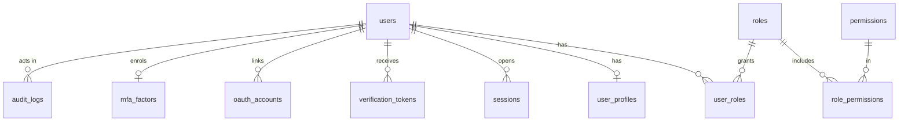
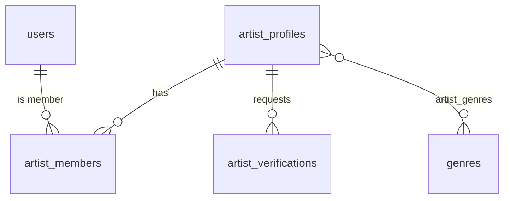
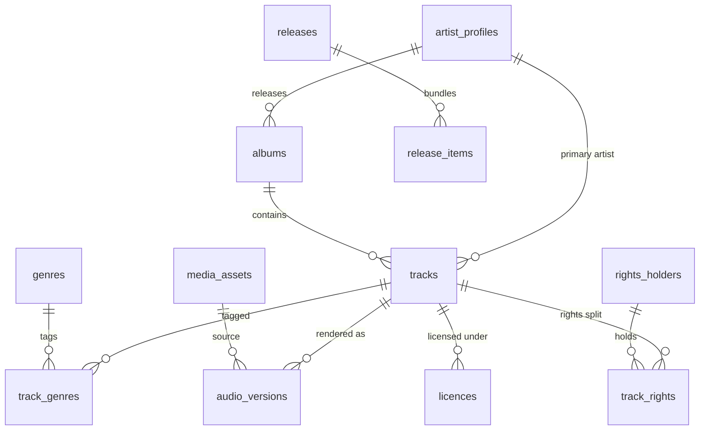
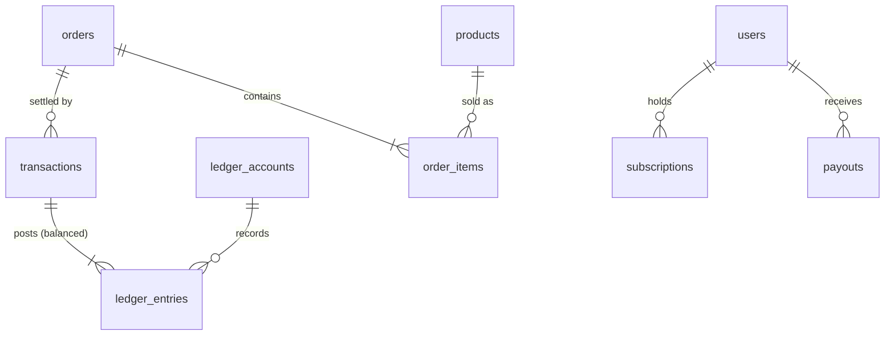

# MusicVerse — Database Entity Relationship Design

Engine: PostgreSQL 16 · ORM: Prisma · Status: Phase 1 tables **implemented**; later domains **designed**.

## 1. Conventions

| Convention | Rule |
|---|---|
| Table names | `snake_case`, plural (`users`, `track_genres`). Prisma models are PascalCase mapped with `@@map`. |
| Primary keys | `uuid` (`gen_random_uuid()` / Prisma `@default(uuid())`). Pure join tables use composite PKs. |
| Timestamps | `created_at timestamptz NOT NULL DEFAULT now()`, `updated_at timestamptz` maintained by Prisma `@updatedAt`. |
| Soft delete | `deleted_at timestamptz NULL` **only** where history must survive deletion: `users`, `artist_profiles`, `tracks`, `albums`, `playlists`, `posts`, `comments`, `communities`, `products`. Unique constraints on soft-deletable rows are partial (`WHERE deleted_at IS NULL`). |
| Money | `bigint` minor units + `char(3)` ISO-4217 currency. Never floats. |
| Enums | Postgres enums via Prisma for closed sets (statuses); lookup tables for open sets (genres, roles). |
| Foreign keys | Always declared; `ON DELETE CASCADE` only for owned children (e.g. session → user); `RESTRICT` for financial and rights records. |
| Indexes | Every FK is indexed; additional composite indexes for primary query paths (documented per table). |
| PII | Kept in `users`/`user_profiles`; anonymised on account deletion after retention window. |
| Append-only | `audit_logs`, `ledger_entries`, `listening_events`, `ai_usage` are never updated or deleted by the application. |

## 2. Identity (Phase 1 — implemented)

| Table | Key columns | Constraints & indexes |
|---|---|---|
| `users` | `id`, `email` (citext semantics via lower-cased storage), `email_verified_at`, `password_hash` (argon2id, nullable for social-only), `status` (`active`,`suspended`,`pending_deletion`,`deleted`), `last_login_at`, `deleted_at` | unique(`email`); idx(`status`) |
| `user_profiles` | `user_id` (PK/FK), `display_name`, `username`, `avatar_url`, `bio`, `country_code`, `locale`, `preferences jsonb` | unique(`username`) |
| `roles` | `id`, `key` (`listener`…`super_admin`), `name`, `description`, `is_staff`, `is_self_assignable` | unique(`key`) |
| `permissions` | `id`, `key` (`catalogue:upload`…), `description` | unique(`key`) |
| `role_permissions` | (`role_id`,`permission_id`) | PK composite |
| `user_roles` | (`user_id`,`role_id`), `granted_by_id`, `created_at` | PK composite; idx(`role_id`) |
| `sessions` | `id`, `user_id`, `refresh_token_hash`, `family_id`, `user_agent`, `ip_address`, `client_type` (`web`,`mobile`,`admin`), `expires_at`, `last_used_at`, `revoked_at`, `revoked_reason` | unique(`refresh_token_hash`); idx(`user_id`,`revoked_at`); idx(`family_id`) |
| `verification_tokens` | `id`, `user_id`, `type` (`email_verification`,`password_reset`), `token_hash`, `expires_at`, `consumed_at` | unique(`token_hash`); idx(`user_id`,`type`) |
| `oauth_accounts` | `id`, `user_id`, `provider` (`google`,`apple`), `provider_account_id`, `email` | unique(`provider`,`provider_account_id`); idx(`user_id`) |
| `mfa_factors` | `id`, `user_id`, `type` (`totp`), `secret_encrypted`, `confirmed_at`, `last_used_step` | unique(`user_id`,`type`) |
| `audit_logs` | `id`, `actor_id` (nullable), `action`, `target_type`, `target_id`, `ip_address`, `user_agent`, `request_id`, `metadata jsonb`, `created_at` | idx(`actor_id`,`created_at`); idx(`target_type`,`target_id`); idx(`action`,`created_at`) |

`sessions.refresh_token_hash` is rotated on every refresh; `family_id` links rotations so token
reuse revokes the family. `mfa_factors.last_used_step` prevents TOTP replay.

## 3. Artists (Phase 2)

- `artist_profiles`: `id`, `slug` (unique, partial), `name`, `bio`, `avatar_asset_id`, `cover_asset_id`, `country_code`, `city`, `social_links jsonb`, `verified_at`, `follower_count` (denormalised, recomputed), `deleted_at`.
- `artist_members`: (`artist_id`,`user_id`) PK, `role` (`owner`,`manager`,`member`), `invited_by_id`, `accepted_at`. Authorisation for artist resources is resolved through this table.
- `artist_verifications`: `id`, `artist_id`, `status` (`pending`,`approved`,`rejected`), `evidence jsonb`, `reviewed_by_id`, `reviewed_at`, `notes`.

## 4. Music catalogue & rights (Phase 2)

- `media_assets`: `id`, `owner_user_id`, `kind` (`audio_master`,`artwork`,`image`,`stem`), `bucket`, `object_key`, `mime_type`, `size_bytes`, `checksum_sha256`, `status` (`pending_upload`,`uploaded`,`scanning`,`ready`,`rejected`), `technical jsonb` (duration, sample rate, channels, loudness).
- `tracks`: `id`, `primary_artist_id`, `album_id?`, `title`, `isrc?` (unique partial), `language` (BCP-47), `duration_ms`, `explicit`, `description`, `release_date`, `status` (`draft`,`processing`,`in_review`,`approved`,`published`,`rejected`,`taken_down`), `master_asset_id`, `artwork_asset_id`, `ownership_declared_at`, `ownership_declared_by_id`, `bpm?`, `musical_key?`, `deleted_at`. idx(`primary_artist_id`,`status`), idx(`status`,`release_date`), GIN trigram on `title`.
- `albums`: `id`, `primary_artist_id`, `title`, `type` (`album`,`single`,`ep`,`compilation`), `upc?`, `release_date`, `artwork_asset_id`, `status`, `deleted_at`.
- `releases` / `release_items`: a scheduled publication of an album or tracks, with territories and `scheduled_at`.
- `genres`: `id`, `slug` unique, `name`, `parent_id?` (hierarchy). `track_genres`: (`track_id`,`genre_id`) PK.
- `audio_versions`: `id`, `track_id`, `source_asset_id`, `format` (`aac`,`opus`,`hls`), `bitrate_kbps`, `object_key`, `loudness_lufs`, `waveform_key`.
- `rights_holders`: `id`, `user_id?`, `artist_id?`, `legal_name`, `type` (`individual`,`publisher`,`label`,`society`), `ipi?`, `contact_email`.
- `track_rights`: `id`, `track_id`, `rights_holder_id`, `right_type` (`master`,`composition`,`neighbouring`), `share_bps` (basis points; sum per type = 10000, enforced in service + deferred check), `territory`.
- `licences`: `id`, `track_id?`, `product_id?`, `type` (`original_owned`,`exclusive`,`non_exclusive`,`creative_commons`,`ai_generated`,`sync`), `licensor_id`, `terms_url`, `commercial_use`, `starts_at`, `ends_at`, `evidence_asset_id?`, `verified_by_id?`.

**Publication invariant:** a track can move to `published` only when: status `approved`, at least
one active licence/ownership declaration, `track_rights` shares complete, and no open takedown.

## 5. Listening (Phase 2)

- `playlists`: `id`, `owner_id`, `title`, `description`, `visibility` (`private`,`unlisted`,`public`), `artwork_asset_id`, `deleted_at`.
- `playlist_tracks`: `id`, `playlist_id`, `track_id`, `position` (fractional `numeric` ordering to avoid renumbering), `added_by_id`, `added_at`; unique(`playlist_id`,`track_id`) optional per playlist setting.
- `favourites`: (`user_id`,`track_id`) PK, `created_at`.
- `playback_sessions`: `id`, `user_id`, `device_id`, `started_at`, `ended_at`, `context_type`, `context_id`.
- `listening_events` (append-only, partitioned monthly by `occurred_at`): `id`, `user_id?`, `track_id`, `playback_session_id`, `event` (`start`,`progress`,`complete`,`skip`), `position_ms`, `country_code`, `occurred_at`. Exported to BigQuery for analytics.

## 6. Discovery (Phase 2–3)

- `search_history`: `id`, `user_id`, `query`, `filters jsonb`, `created_at` (90-day retention).
- `recommendations`: `id`, `user_id`, `item_type`, `item_id`, `score`, `reason`, `model_version`, `generated_at`, `expires_at`.
- `trending_scores`: (`item_type`,`item_id`,`region`,`window`) PK, `score`, `computed_at`.

## 7. Social (Phase 3)

- `posts`: `id`, `author_user_id`, `artist_id?`, `community_id?`, `body`, `attachments jsonb`, `visibility`, `reply_count`, `like_count`, `deleted_at`.
- `comments`: `id`, `post_id`, `author_id`, `parent_comment_id?` (replies), `body`, `deleted_at`.
- `likes`: (`user_id`,`target_type`,`target_id`) PK — polymorphic on post/comment/track.
- `follows`: (`follower_id`,`followee_type`,`followee_id`) PK — users or artists; idx(`followee_type`,`followee_id`).
- `blocks`: (`blocker_id`,`blocked_id`) PK.
- `communities`: `id`, `slug`, `name`, `description`, `visibility`, `owner_id`, `deleted_at`.
- `community_members`: (`community_id`,`user_id`) PK, `role` (`owner`,`moderator`,`member`), `joined_at`.
- `notifications`: `id`, `user_id`, `type`, `actor_id?`, `payload jsonb`, `read_at`, `created_at`; idx(`user_id`,`read_at`,`created_at`).

## 8. Creation (Phase 4)

- `projects`: `id`, `owner_id`, `title`, `bpm`, `musical_key`, `time_signature`, `status`.
- `recordings`: `id`, `project_id`, `asset_id`, `title`, `take_number`, `duration_ms`, `metadata jsonb`.
- `stems`: `id`, `project_id?`, `track_id?`, `asset_id`, `stem_type` (`vocals`,`drums`,`bass`,`other`…), `source` (`uploaded`,`ai_separated`), `ai_generation_id?`.
- `collaborations`: `id`, `project_id`, `user_id`, `role` (`owner`,`editor`,`viewer`), `split_bps?`, `invited_at`, `accepted_at`.

Multitrack-ready: `project_tracks`/`clips` tables reserved for future timeline editing.

## 9. AI (Phase 4)

- `ai_providers`: `id`, `key`, `name`, `capabilities text[]`, `terms_url`, `commercial_use_allowed`, `enabled`.
- `ai_jobs`: `id`, `user_id`, `provider_id`, `capability`, `status` (`queued`,`running`,`succeeded`,`failed`,`cancelled`), `input jsonb`, `idempotency_key`, `cost_credits`, `error`, timestamps.
- `ai_generations`: `id`, `job_id`, `asset_id?`, `text_output?`, `model`, `model_version`, `provider_request_id`, `commercial_use_permitted`, `usage_terms_snapshot jsonb`, `generated_at`.
- `ai_usage` (append-only): `id`, `user_id`, `job_id`, `provider_id`, `units`, `unit_type`, `cost_minor`, `currency`.
- `ai_credit_transactions`: `id`, `user_id`, `delta`, `reason` (`purchase`,`grant`,`consumption`,`refund`), `ai_job_id?`, `ledger_transaction_id?`, `balance_after`.

## 10. Business & finance (Phase 5)

- `products`: `id`, `seller_user_id`, `artist_id?`, `type` (`beat`,`sample_pack`,`service`,`licence`,`subscription_plan`,`credit_pack`), `title`, `price_minor`, `currency`, `licence_template_id?`, `status`, `deleted_at`.
- `orders`: `id`, `buyer_id`, `status` (`pending`,`paid`,`fulfilled`,`refunded`,`cancelled`), `total_minor`, `currency`, `idempotency_key` unique.
- `order_items`: `id`, `order_id`, `product_id`, `quantity`, `unit_price_minor`, `licence_id?`.
- `transactions`: `id`, `type` (`payment`,`refund`,`payout`,`tip`,`fee`,`credit_purchase`), `status` (`pending`,`succeeded`,`failed`), `provider`, `provider_reference` unique per provider, `verified_at` (set **only** after webhook signature + provider lookup), `order_id?`, `idempotency_key` unique.
- `subscriptions`: `id`, `user_id`, `plan_product_id`, `provider`, `provider_subscription_id`, `status`, `current_period_end`, `cancel_at`.
- `payouts`: `id`, `user_id`, `amount_minor`, `currency`, `status`, `provider`, `provider_reference`, `transaction_id`.
- `ledger_accounts`: `id`, `owner_type` (`platform`,`user`,`provider_clearing`), `owner_id?`, `type` (`asset`,`liability`,`revenue`,`expense`), `currency`, `code` unique.
- `ledger_entries` (append-only): `id`, `transaction_id`, `account_id`, `direction` (`debit`,`credit`), `amount_minor > 0`, `currency`, `created_at`.

**Double-entry invariant:** for each `transaction_id` and currency, Σdebits = Σcredits. Enforced by
writing all entries in one DB transaction through `LedgerService.post()` plus a deferred constraint
trigger. Balances are derived (materialised view refreshed periodically, verified nightly).
No card data (PAN/CVV) is ever stored; only provider tokens/references.

## 11. Marketing (Phase 3–5)

- `campaigns`: `id`, `artist_id`, `name`, `objective`, `status`, `budget_minor?`, `currency?`, `starts_at`, `ends_at`.
- `campaign_assets`: `id`, `campaign_id`, `asset_id?`, `type`, `copy`, `ai_generation_id?`.
- `campaign_metrics`: (`campaign_id`,`date`,`metric`) PK, `value`.

## 12. Governance (Phase 2 core, Phase 1 audit logs)

- `content_reports`: `id`, `reporter_id?`, `target_type`, `target_id`, `reason` (`copyright`,`abuse`,`spam`,`explicit_mislabel`,`other`), `details`, `status`, `assigned_to_id?`, `resolved_at`.
- `takedown_requests`: `id`, `track_id?`/`target_type`+`target_id`, `claimant_name`, `claimant_email`, `rights_basis`, `sworn_statement_at`, `status` (`received`,`actioned`,`rejected`,`counter_noticed`,`restored`), `actioned_by_id`, `actioned_at`.
- `appeals`: `id`, `takedown_request_id?`/`content_report_id?`, `appellant_id`, `statement`, `status`, `decided_by_id`, `decided_at`, `decision_notes`.
- `audit_logs`: see §2.

## 13. Migrations policy

- Prisma Migrate, one migration per logical change, committed under `apps/api/prisma/migrations`.
- Production applies with `prisma migrate deploy` from CI before the new revision receives traffic.
- Destructive changes follow expand → migrate data → contract across two releases.
- Raw SQL migrations are used for features Prisma cannot express (partial unique indexes, triggers,
  partitioning, `pg_trgm`).
